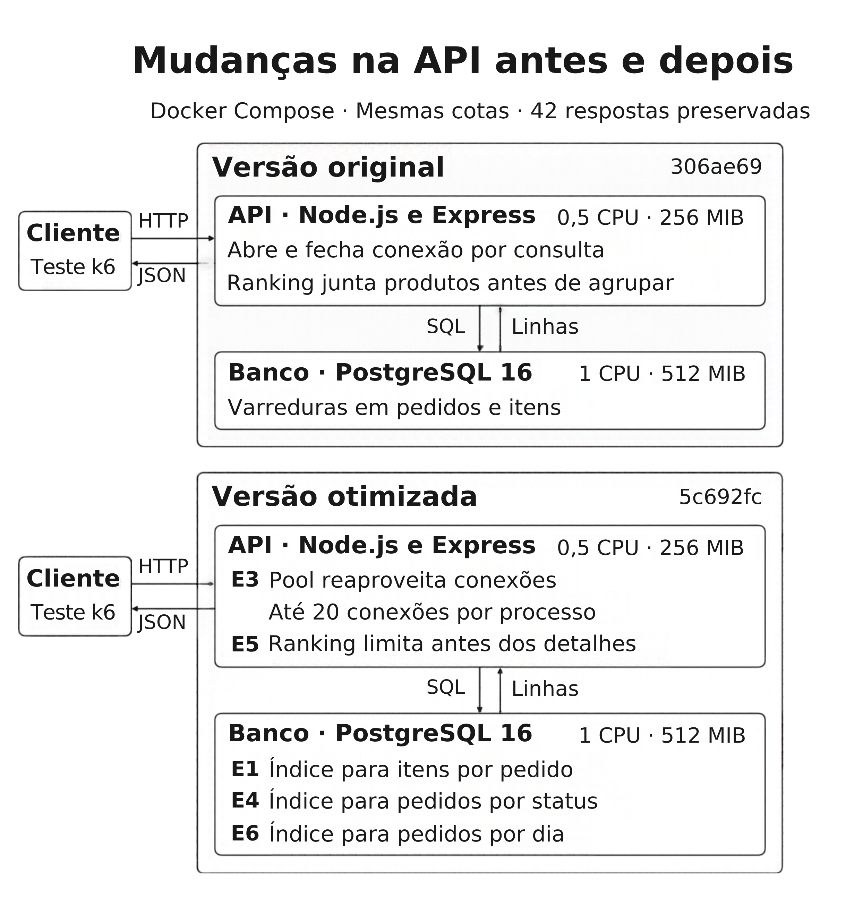
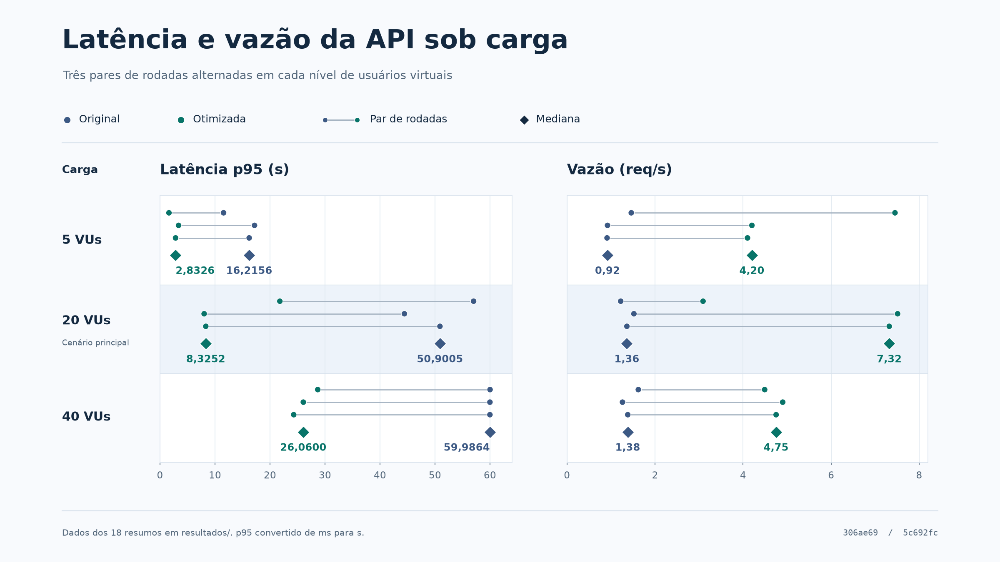
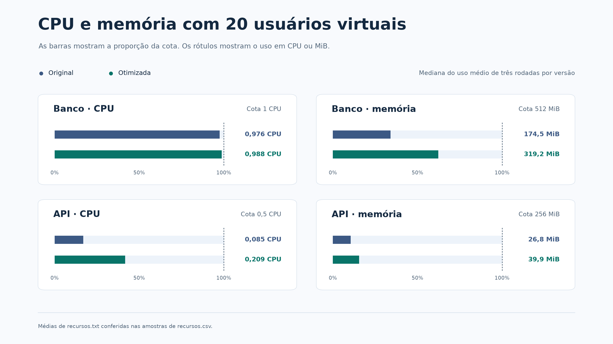

# Índices e reescrita de consultas reduziram a latência de uma API de loja sob carga

## 1. Resumo

Pedidos e relatórios demoravam sob carga. O conjunto de índices, pool e ranking reescrito elevou a vazão mediana de 1,36 para 7,32 req/s com 20 usuários virtuais e cotas iguais. O tempo das requisições mais lentas (p95) mediano caiu de 50.900,5 para 8.325,2 ms. As 42 respostas do contrato foram preservadas. O uso de memória subiu nos dois contêineres e o de CPU, na API. GIN e cota menor ficaram fora.

## 2. Contexto e diagnóstico

A API usa Node.js, Express e PostgreSQL 16 em Docker, com 500 mil pedidos e 1,5 milhão de itens sintéticos. As cotas são 0,5 CPU e 256 MiB na API, 1 CPU e 512 MiB no banco. Na base, as medianas foram 1,40 req/s, p95 de 49.653,4 ms e 99,9% de um núcleo na CPU média do banco. [Dados](../banco/02-dados.sql) · [Cotas](../docker-compose.yml) · [Base](#6-experimento-e-resultado)

**Hipóteses de causa**

- O `EXPLAIN (ANALYZE, BUFFERS)` mostrou varreduras e ordenações sem índices por pedido e cliente. [Itens](../diagnostico/01-itens-pedido-antes.txt) · [Pedidos](../diagnostico/02-pedidos-cliente-antes.txt)
- Contagem e paginação por status varriam pedidos. Parte da ordenação usava disco. [Planos](../diagnostico/08-pedidos-status-antes.txt)
- O relatório diário filtrava `criado_em::date` na varredura. O ranking juntava detalhes antes de agregar. [Vendas](../diagnostico/12-vendas-por-dia-antes.txt) · [Ranking](../diagnostico/10-top-produtos-antes.txt)
- Conectar por consulta e buscar itens por pedido e produtos por item repetia trabalho. [Pool](../experimentos.md#e3--pool-de-conexões) · [Contagem](../diagnostico/14-pedidos-cliente-lote-antes.txt)
- Os termos com `ILIKE` geraram varreduras. Na busca por e-mail, o p50 mediano foi 3.599,9 ms. Falta investigar `lower(email)`. [Busca](../diagnostico/15-busca-produtos-sem-gin.txt) · [E-mail](../api/src/rotas.js)

## 3. Estado da arte

### Índices

Chaudhuri e Narasayya (1997) selecionam índices pelo custo das consultas. O B-tree por status, data e ID atende ao filtro e à ordenação. [Artigo](https://www.vldb.org/conf/1997/P146.PDF) · [Multicoluna](https://www.postgresql.org/docs/16/indexes-multicolumn.html) · [Ordenação](https://www.postgresql.org/docs/16/indexes-ordering.html)

O índice por expressão guarda a data calculada. Seu predicado parcial exclui cancelados. Para `ILIKE`, `pg_trgm` permite GIN em buscas por trecho. [Expressão](https://www.postgresql.org/docs/16/indexes-expressional.html) · [Parcial](https://www.postgresql.org/docs/16/indexes-partial.html) · [Trigramas](https://www.postgresql.org/docs/16/pgtrgm.html)

### Relatórios

Yan e Larson (1994) mostram quando agregar antes da junção preserva resultados. A chave estrangeira permite agregar por ID antes da junção. Views materializadas guardam totais sujeitos a defasagem. [Artigo](https://www.microsoft.com/en-us/research/publication/performing-group-by-before-join/) · [Esquema](../banco/01-estrutura.sql) · [Views](https://www.postgresql.org/docs/16/rules-materializedviews.html)

### Conexões e lote

O `node-postgres` recomenda reutilizar conexões por pool. A Zalando avaliou PgBouncer no Kubernetes. [Driver](https://node-postgres.com/features/pooling) · [Zalando](https://engineering.zalando.com/posts/2020/06/postgresql-connection-poolers.html)

Guravannavar e Sudarshan (2008) agrupam chamadas em lotes. O GitLab usou carregamento conjunto ao criar projetos. [Artigo](https://www.vldb.org/pvldb/vol1/1453975.pdf) · [GitLab](https://gitlab.com/gitlab-org/gitlab/-/merge_requests/131869)

### Recursos

O `work_mem` limita memória por ordenação antes de usar temporários. O Compose limita CPU por serviço. [PostgreSQL](https://www.postgresql.org/docs/16/runtime-config-resource.html) · [Compose](https://docs.docker.com/reference/compose-file/deploy/#resources)

## 4. Alternativas consideradas

Os percentuais usam medianas. Riscos e esforço são estimativas.

| Alternativa | Custo | Desempenho | Risco | Esforço |
|---|---|---|---|---|
| Índices de itens, status e data | Disco e escrita | Vazão +22%, +28% e +52%, respectivamente | Ganho variável | Baixo |
| Índice por cliente | Disco e escrita | SQL isolado mais rápido, vazão −8%, p95 −6% | Efeito global incerto | Baixo |
| Ranking reescrito | Manter SQL | p95 geral −35% | Cálculo e desempate | Médio |
| Pool | Memória das conexões | p50 menor, p95 +4%, vazão +3% | Fila | Baixo |
| Busca em lote | Agrupamento em memória | Vazão −21% | Ordem dos itens | Médio |
| GIN | 1.171.456 bytes e manutenção | p95 da busca −49%, vazão geral −29% | Ganho por termo | Baixo |
| API com `0,4 CPU` | Cota −20% | Vazão −38% | Latência sob carga | Baixo |
| View materializada | Disco e atualização | Pode poupar recálculo | Defasagem | Médio |
| Mais `work_mem` | Memória por operação | Pode reduzir temporários | Consumo concorrente | Baixo |

## 5. Solução escolhida e por quê

Foi mantida `5c692fc`, com índices de itens, status e dia, ranking reescrito e `pg.Pool`. Teve maior vazão e menor p95 nos complementares. O ranking busca detalhes após limitar e preserva o desempate por ID. O pool ficou pelo reuso e menor p50, com efeito isolado inconclusivo em vazão e p95. [Plano](../diagnostico/11-top-produtos-depois.txt) · [Experimentos](../experimentos.md)

*Diagrama elaborado no Canva. E2 e E7 foram revertidos.*

A comparação sob carga orientou a escolha (Gregg, 2020). E2 ficou inconclusivo. O lote reduziu as consultas do cliente 42 de 17 para 3 e registrou menor vazão. GIN e `0,4 CPU` ficaram fora pela vazão menor. [Gregg](https://www.oreilly.com/library/view/systems-performance-2nd/9780136821694/ch12.xhtml)

A view exige avaliar defasagem, o `work_mem` exige medir memória sob concorrência e o cursor, preservar acesso por número de página.

A vazão foi 5,4 vezes a original. Com preço horário igual, isso reduziria o custo por requisição. A memória passou de 174,5 para 319,2 MiB no banco e de 26,8 para 39,9 MiB na API. Os índices ocuparam 59.088.896 bytes. A manutenção nas escritas (Kleppmann, 2017) ficou em aberto. [Recursos](../experimentos.md#recursos-e-custo) · [Kleppmann](https://www.oreilly.com/library/view/designing-data-intensive-applications/9781491903063/ch03.html)

## 6. Experimento e resultado

Cada mudança teve commit. O k6 usou 20 usuários nos incrementais, 15 s de aquecimento, 60 s de carga e semente 42. O p50 é a latência mediana. Cerca de 95% das durações ficam até o p95. As tabelas usam medianas, inclusive das médias de CPU (% de um núcleo) e memória (MiB) por contêiner.

E2 teve cinco rodadas em condições distintas de energia. Após a reversão, E1 foi repetido na tomada como referência de E3. E6 e E7 ocorreram em horários diferentes. Cada linha usa sua referência. O efeito conjunto vem da validação pareada. [Procedimento](../experimentos.md#procedimento-e-rastreabilidade)

| Mudança | Hipótese | p95 antes → depois (ms) | req/s antes → depois | CPU/memória | Pastas de resultados | Conclusão |
| --- | --- | ---: | ---: | --- | --- | --- |
| E1 · Índice de itens | Índice reduz leituras. | 49.653,4 → 32.673,9 | 1,40 → 1,71 | Banco 99,9→98,7 / 402,5→394,9 API 7,7→14,9 / 28,6→33,3 | Base [1](../resultados/20261110-171634-00-linha-de-base/) [2](../resultados/20261110-172205-00-linha-de-base/) [3](../resultados/20261110-172503-00-linha-de-base/) E1 [1](../resultados/20261110-212550-01-indice-itens-pedido/) [2](../resultados/20261110-212821-01-indice-itens-pedido/) [3](../resultados/20261110-213056-01-indice-itens-pedido/) | Vazão maior, p95 menor, p50 maior. Mantido. |
| E2 · Índice por cliente | Índice cobre filtro e ordem. | 32.673,9 → 30.711,9 | 1,71 → 1,58 | Banco 98,7→97,1 / 394,9→393,7 API 14,9→14,0 / 33,3→35,2 | E1 [1](../resultados/20261110-212550-01-indice-itens-pedido/) [2](../resultados/20261110-212821-01-indice-itens-pedido/) [3](../resultados/20261110-213056-01-indice-itens-pedido/) E2 [1](../resultados/20261110-224519-02-indice-pedidos-cliente/) [2](../resultados/20261110-224821-02-indice-pedidos-cliente/) [3](../resultados/20261110-225102-02-indice-pedidos-cliente/) [4](../resultados/20261110-230602-02-indice-pedidos-cliente/) [5](../resultados/20261110-231346-02-indice-pedidos-cliente/) | SQL mais rápido. [Plano](../diagnostico/06-pedidos-cliente-depois-02.txt). Inconclusivo. Revertido. |
| E3 · Pool | Reuso evita reconexões. | 23.346,4 → 24.357,9 | 2,74 → 2,83 | Banco 94,4→95,1 / 387,4→392,4 API 12,9→12,1 / 39,5→43,7 | Tomada [1](../resultados/20261111-001913-01-indice-itens-tomada/) [2](../resultados/20261111-002136-01-indice-itens-tomada/) [3](../resultados/20261111-002341-01-indice-itens-tomada/) E3 [1](../resultados/20261111-004437-03-pool-conexoes/) [2](../resultados/20261111-004657-03-pool-conexoes/) [3](../resultados/20261111-004903-03-pool-conexoes/) | p50 menor, p95 maior. Mantido. |
| E4 · Índice por status | Índice agiliza contagem e página. | 24.357,9 → 26.459,7 | 2,83 → 3,61 | Banco 95,1→98,4 / 392,4→413,2 API 12,1→17,0 / 43,7→52,4 | E3 [1](../resultados/20261111-004437-03-pool-conexoes/) [2](../resultados/20261111-004657-03-pool-conexoes/) [3](../resultados/20261111-004903-03-pool-conexoes/) E4 [1](../resultados/20261111-011109-04-indice-pedidos-status/) [2](../resultados/20261111-011349-04-indice-pedidos-status/) [3](../resultados/20261111-011611-04-indice-pedidos-status/) | Vazão maior. p95 menor na rota e maior no geral. Mantido. |
| E5 · Ranking | Agregar e limitar reduz trabalho na junção com produtos. | 26.459,7 → 17.109,9 | 3,61 → 4,31 | Banco 98,4→98,9 / 413,2→425,5 API 17,0→18,6 / 52,4→51,4 | E4 [1](../resultados/20261111-011109-04-indice-pedidos-status/) [2](../resultados/20261111-011349-04-indice-pedidos-status/) [3](../resultados/20261111-011611-04-indice-pedidos-status/) E5 [1](../resultados/20261111-015733-05-ranking-produtos/) [2](../resultados/20261111-015941-05-ranking-produtos/) [3](../resultados/20261111-020132-05-ranking-produtos/) | Vazão maior, p95 menor, p50 maior. Mantido. |
| E6 · Índice por dia | Indexar a data reduz leituras. | 17.109,9 → 10.458,9 | 4,31 → 6,53 | Banco 98,9→99,8 / 425,5→427,7 API 18,6→20,0 / 51,4→48,7 | E5 [1](../resultados/20261111-015733-05-ranking-produtos/) [2](../resultados/20261111-015941-05-ranking-produtos/) [3](../resultados/20261111-020132-05-ranking-produtos/) E6 [1](../resultados/20261111-023355-06-indice-vendas-por-dia/) [2](../resultados/20261111-023539-06-indice-vendas-por-dia/) [3](../resultados/20261111-023720-06-indice-vendas-por-dia/) | Vazão maior e p95 geral e da rota menores. Mantido. |
| E7 · Busca em lote | Lote reduz consultas. | 10.458,9 → 13.337,7 | 6,53 → 5,19 | Banco 99,8→100,5 / 427,7→422,7 API 20,0→18,7 / 48,7→47,6 | E6 [1](../resultados/20261111-023355-06-indice-vendas-por-dia/) [2](../resultados/20261111-023539-06-indice-vendas-por-dia/) [3](../resultados/20261111-023720-06-indice-vendas-por-dia/) E7 [1](../resultados/20261111-191505-07-pedidos-em-lote/) [2](../resultados/20261111-191750-07-pedidos-em-lote/) [3](../resultados/20261111-192052-07-pedidos-em-lote/) | Vazão menor e p95 maior na série. Revertido. |

### Validação da configuração escolhida

Cada carga teve três pares alternados entre original (`306ae69`) e otimizada (`5c692fc`). Com 40 usuários, a original somou 85 falhas, com p95 próximo do timeout de 60 s. A otimizada teve zero falhas a 40 e um timeout no ranking na primeira rodada a 20. Contrato preservado em todas. [Carga](../carga/teste-carga.js)

| Usuários virtuais | Vazão (req/s) | p95 (ms) | Taxa mediana de erros | Pastas de resultados |
| ---: | ---: | ---: | ---: | --- |
| 5 | 0,92 → 4,20 | 16.215,6 → 2.832,6 | 0,00% → 0,00% | Original [1](../resultados/20261112-153542-09-validacao-original-5vus/) [2](../resultados/20261112-153942-09-validacao-original-5vus/) [3](../resultados/20261112-154432-09-validacao-original-5vus/) Otimizada [1](../resultados/20261112-153753-09-validacao-otimizada-5vus/) [2](../resultados/20261112-154214-09-validacao-otimizada-5vus/) [3](../resultados/20261112-154722-09-validacao-otimizada-5vus/) |
| **20** | **1,36 → 7,32** | **50.900,5 → 8.325,2** | 1,77% → 0,00% | Original [1](../resultados/20261111-221617-08-validacao-original-20vus/) [2](../resultados/20261111-224934-08-validacao-original-20vus/) [3](../resultados/20261111-225344-08-validacao-original-20vus/) Otimizada [1](../resultados/20261111-222012-08-validacao-otimizada-20vus/) [2](../resultados/20261111-225157-08-validacao-otimizada-20vus/) [3](../resultados/20261111-225612-08-validacao-otimizada-20vus/) |
| 40 | 1,38 → 4,75 | 59.986,4 → 26.060,0 | 25,00% → 0,00% | Original [1](../resultados/20261112-160417-10-validacao-original-40vus/) [2](../resultados/20261112-161054-10-validacao-original-40vus/) [3](../resultados/20261112-161648-10-validacao-original-40vus/) Otimizada [1](../resultados/20261112-160821-10-validacao-otimizada-40vus/) [2](../resultados/20261112-161423-10-validacao-otimizada-40vus/) [3](../resultados/20261112-162053-10-validacao-otimizada-40vus/) |

*Linhas unem pares. Losangos indicam medianas.*

*Uso relativo à cota. Médias conferidas nos CSVs. [Recursos](../experimentos.md#validação-da-versão-otimizada-com-20-usuários-virtuais).*

### Experimentos complementares

Três blocos de 14/11 compararam `5c692fc`, GIN (`70042d9`) e `0,4 CPU` (`4678071`) com 20 usuários. A referência com `0,5 CPU` fez 6,82 req/s nessa série e 7,32 na validação de 11/11. Contrato preservado e zero erros nas nove rodadas. Referência [1](../resultados/20261114-220214-11-referencia-otimizada-20vus/) [2](../resultados/20261114-221926-11-referencia-otimizada-20vus/) [3](../resultados/20261114-222343-11-referencia-otimizada-20vus/).

| Mudança | Hipótese | p95 geral antes → depois (ms) | req/s antes → depois | CPU/memória | Pastas de resultados | Conclusão |
| --- | --- | ---: | ---: | --- | --- | --- |
| GIN na busca | Índice reduz p95 da busca. | 9.632,3 → 11.394,7 | 6,82 → 4,84 | Banco 98,8→97,2 / 340,0→322,7 API 19,9→21,7 / 42,2→45,0 | [1](../resultados/20261114-220612-11-gin-produtos-20vus/) [2](../resultados/20261114-221354-11-gin-produtos-20vus/) [3](../resultados/20261114-222556-11-gin-produtos-20vus/) | Busca de 1.743,5 para 893,1 ms no p95. Vazão menor nos três blocos. Descartado. |
| API com `0,4 CPU` | API sustenta carga com teto menor. | 9.632,3 → 14.353,2 | 6,82 → 4,24 | Banco 98,8→96,5 / 340,0→305,5 API 19,9→21,7 / 42,2→47,2 | [1](../resultados/20261114-221105-12-cota-api-04-20vus/) [2](../resultados/20261114-221644-12-cota-api-04-20vus/) [3](../resultados/20261114-222134-12-cota-api-04-20vus/) | Vazão mediana menor e p95 maior. Descartada. |

O plano usou GIN. O tempo SQL caiu de 18,101 a 2,826 ms em `cadeira` e de 15,460 a 2,037 ms em `modelo 12`. A menor vazão segue sem causa confirmada. [Antes](../diagnostico/15-busca-produtos-sem-gin.txt) · [Depois](../diagnostico/16-busca-produtos-com-gin.txt)

## 7. Limites e testes futuros

Os testes usaram leituras sobre dados sintéticos num notebook. Com 20 usuários, o p95 otimizado foi 8.325,2 ms e o banco usou 98,8% da cota, indício de gargalo. A 40 usuários, o p95 foi 26.060,0 ms. O contrato cobre 42 casos. Escritas concorrentes e a causa da lentidão por e-mail (15% da carga) seguem em aberto.

Kalibera e Jones (2013) usam repetições para quantificar a variação. A escolha deve ser revista se a vantagem em vazão ou p95 desaparecer em nova validação alternada, com carga e cotas iguais. As fichas propõem repetir o GIN para verificar o ganho na busca com vazão geral comparável, medir a limitação de CPU, testar 128 MiB na API e diagnosticar o e-mail. [Estudo](https://kar.kent.ac.uk/33611/) · [Próximos testes](../proximos-testes.md)

## 8. Referências

1. CHAUDHURI, Surajit e NARASAYYA, Vivek. [**An Efficient, Cost-Driven Index Selection Tool for Microsoft SQL Server**](https://www.vldb.org/conf/1997/P146.PDF). VLDB, 1997. Acesso em 4 nov. 2026.

2. POSTGRESQL. [**Multicolumn Indexes**](https://www.postgresql.org/docs/16/indexes-multicolumn.html). Documentação do PostgreSQL 16. Acesso em 6 nov. 2026.

3. POSTGRESQL. [**Indexes and ORDER BY**](https://www.postgresql.org/docs/16/indexes-ordering.html). Documentação do PostgreSQL 16. Acesso em 7 nov. 2026.

4. POSTGRESQL. [**Indexes on Expressions**](https://www.postgresql.org/docs/16/indexes-expressional.html). Documentação do PostgreSQL 16. Acesso em 8 nov. 2026.

5. POSTGRESQL. [**Partial Indexes**](https://www.postgresql.org/docs/16/indexes-partial.html). Documentação do PostgreSQL 16. Acesso em 10 nov. 2026.

6. YAN, Weipeng P. e LARSON, Per-Åke. [**Performing Group-by before Join**](https://www.microsoft.com/en-us/research/publication/performing-group-by-before-join/). IEEE International Conference on Data Engineering, 1994. Acesso em 5 nov. 2026.

7. POSTGRESQL. [**Materialized Views**](https://www.postgresql.org/docs/16/rules-materializedviews.html). Documentação do PostgreSQL 16. Acesso em 9 nov. 2026.

8. NODE-POSTGRES. [**Pooling**](https://node-postgres.com/features/pooling). Documentação oficial. Acesso em 8 nov. 2026.

9. DOLGOV, Dmitrii. [**PgBouncer on Kubernetes and how to achieve minimal latency**](https://engineering.zalando.com/posts/2020/06/postgresql-connection-poolers.html). Zalando Engineering, 2020. Acesso em 6 nov. 2026.

10. GURAVANNAVAR, Ravindra e SUDARSHAN, S. [**Rewriting Procedures for Batched Bindings**](https://www.vldb.org/pvldb/vol1/1453975.pdf). Proceedings of the VLDB Endowment, v. 1, n. 1, p. 1107–1123, 2008. Acesso em 6 nov. 2026.

11. GITLAB. [**Fix performance problem with Projects#new page**](https://gitlab.com/gitlab-org/gitlab/-/merge_requests/131869). Merge request !131869, 2023. Acesso em 10 nov. 2026.

12. GREGG, Brendan. [**Systems Performance: Enterprise and the Cloud**](https://www.oreilly.com/library/view/systems-performance-2nd/9780136821694/ch12.xhtml). 2. ed. Addison-Wesley, 2020. Cap. 12, **Benchmarking**. Acesso em 12 nov. 2026.

13. KLEPPMANN, Martin. [**Designing Data-Intensive Applications**](https://www.oreilly.com/library/view/designing-data-intensive-applications/9781491903063/ch03.html). O’Reilly Media, 2017. Cap. 3, **Storage and Retrieval**. Acesso em 12 nov. 2026.

14. KALIBERA, Tomas e JONES, Richard E. [**Rigorous Benchmarking in Reasonable Time**](https://kar.kent.ac.uk/33611/). ACM SIGPLAN International Symposium on Memory Management, 2013. Acesso em 5 nov. 2026.

15. POSTGRESQL. [**pg_trgm**](https://www.postgresql.org/docs/16/pgtrgm.html). Documentação do PostgreSQL 16. Acesso em 15 nov. 2026.

16. POSTGRESQL. [**Resource Consumption**](https://www.postgresql.org/docs/16/runtime-config-resource.html). Documentação do PostgreSQL 16. Acesso em 15 nov. 2026.

17. DOCKER. [**Compose Deploy Specification**](https://docs.docker.com/reference/compose-file/deploy/#resources). Documentação do Docker Compose. Acesso em 15 nov. 2026.

## 9. Uso de IA

O ChatGPT e o Gemini apoiaram a formulação de string de busca no Google Acadêmico, a interpretação dos planos SQL e a redação do artigo. O ChatGPT também auxiliou na reescrita da consulta do ranking e na elaboração do [script em Python com Matplotlib](gerar_figuras.py), usado para gerar os dois gráficos a partir de `resultados/`.

As fontes foram conferidas nos originais de forma manual. As mudanças da API foram verificadas com o contrato e os testes de carga. Os números do artigo e das figuras foram conferidos nos arquivos de `resultados/`.
