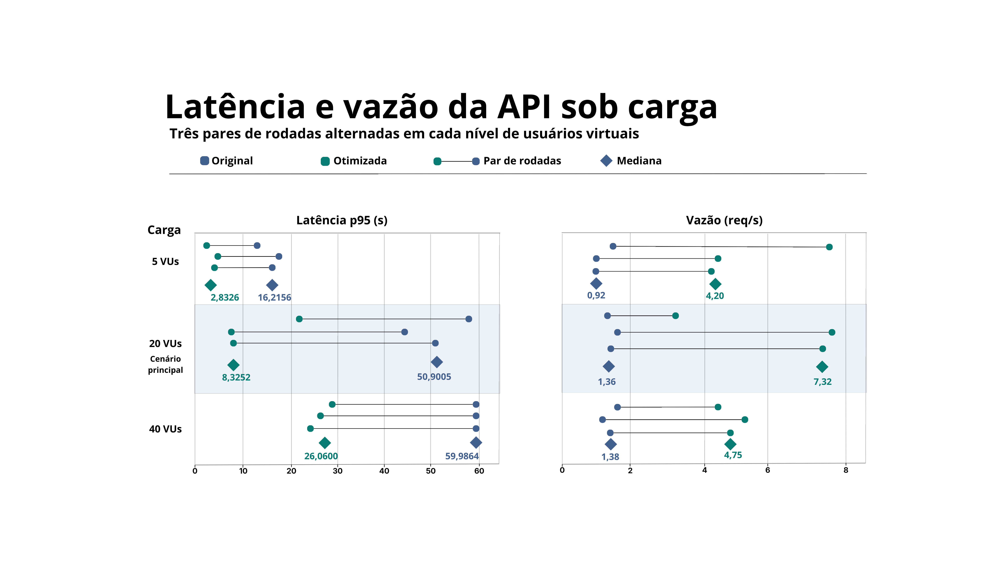
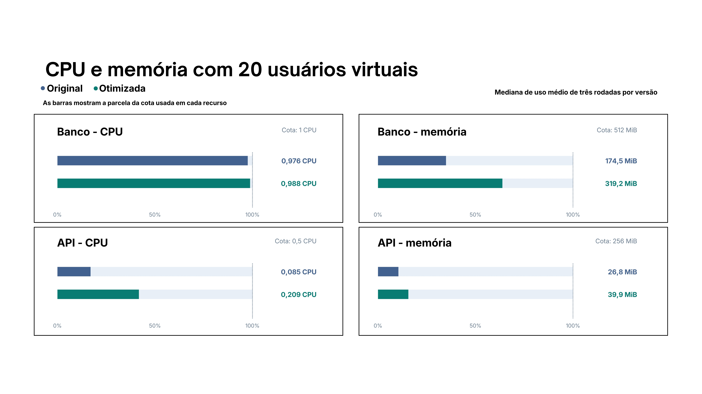

# Índices e reescrita de consultas reduziram a latência de uma API de loja sob carga

## 1. Resumo

Sob carga concorrente, uma API de comércio eletrônico apresentava respostas lentas nas consultas de pedidos e relatórios. A análise do código e dos planos SQL orientou a criação de índices no PostgreSQL, a reutilização de conexões e a reescrita do ranking de produtos. Com 20 usuários virtuais e as mesmas cotas de CPU e memória, a vazão mediana passou de 1,36 para 7,32 requisições por segundo, e a mediana do p95 caiu de 50.900,5 para 8.325,2 ms. A versão otimizada reproduziu as 42 respostas verificadas pelo contrato.

## 2. Contexto e diagnóstico

A API usa Node.js, Express e PostgreSQL 16 em Docker, com 500 mil pedidos e 1,5 milhão de itens sintéticos. Na linha de base, as medianas foram 1,40 requisição por segundo e p95 de 49.653,4 ms. A CPU média do banco ficou em 99,9%, próxima da cota de um núcleo. Esse uso orientou a leitura do código e dos planos obtidos com `EXPLAIN (ANALYZE, BUFFERS)`. [Dados](../banco/02-dados.sql) · [Linha de base](#6-experimento-e-resultado)

**Hipóteses de causa**

- **Itens do pedido.** Sem índice por pedido e ID, o banco varria a tabela e ordenava os itens encontrados. [Plano](../diagnostico/01-itens-pedido-antes.txt)
- **Pedidos por cliente.** A ausência de um índice adequado ao filtro e à ordem levou a uma varredura seguida de ordenação. [Plano](../diagnostico/02-pedidos-cliente-antes.txt)
- **Pedidos por status.** Contagem e paginação varriam a tabela, e parte da ordenação da página usava disco. [Planos](../diagnostico/08-pedidos-status-antes.txt)
- **Vendas por dia.** O filtro por `criado_em::date` exigia avaliar a data ao varrer os pedidos. [Plano](../diagnostico/12-vendas-por-dia-antes.txt)
- **Ranking de produtos.** A junção trazia nome e categoria antes de agregar as vendas e selecionar os primeiros produtos. [Plano](../diagnostico/10-top-produtos-antes.txt)
- **Conexões.** A abertura de uma sessão por consulta acrescentava trabalho, conforme `git show 306ae69:api/src/db.js`. [Registro](../experimentos.md#e3--pool-de-conexões)
- **Montagem dos pedidos.** Buscar itens por pedido e produtos por item multiplicava as consultas. [Contagem de pedidos e itens](../diagnostico/14-pedidos-cliente-lote-antes.txt)

## 3. Estado da arte

### Índices orientados às consultas

Chaudhuri e Narasayya (1997) selecionam índices a partir das consultas da carga. Na listagem de pedidos, um índice B-tree por status, data e ID acompanha o filtro e a ordenação. [Chaudhuri e Narasayya](https://www.vldb.org/conf/1997/P146.PDF) · [Índices multicoluna](https://www.postgresql.org/docs/16/indexes-multicolumn.html) · [Ordenação](https://www.postgresql.org/docs/16/indexes-ordering.html)

No relatório diário, um índice por expressão guarda a data calculada, e o predicado parcial restringe as entradas aos pedidos considerados. A combinação reduz o trabalho de localizar os registros do período. [Índices por expressão](https://www.postgresql.org/docs/16/indexes-expressional.html) · [Índices parciais](https://www.postgresql.org/docs/16/indexes-partial.html)

### Reescrita e pré-cálculo de relatórios

Yan e Larson (1994) mostram que agrupar antes de uma junção pode reduzir o volume de dados processado quando a transformação preserva o resultado. Como cada item referencia um produto existente, o ranking pode agregar por ID e buscar os detalhes só dos produtos selecionados. Uma view materializada também permite consultar totais prontos, que podem ficar defasados entre atualizações. [Yan e Larson](https://www.microsoft.com/en-us/research/publication/performing-group-by-before-join/) · [Esquema](../banco/01-estrutura.sql) · [Views materializadas](https://www.postgresql.org/docs/16/rules-materializedviews.html)

### Reutilização de conexões e consultas em lote

O `node-postgres` recomenda reaproveitar conexões por meio de um pool. A Zalando avaliou a latência dessa estratégia com PgBouncer em Kubernetes, e a API do desafio a testou no próprio driver. [node-postgres](https://node-postgres.com/features/pooling) · [Zalando](https://engineering.zalando.com/posts/2020/06/postgresql-connection-poolers.html)

Guravannavar e Sudarshan (2008) estudam como substituir chamadas repetidas por operações em lote. O GitLab usou carregamento conjunto para evitar consultas repetidas ao criar projetos. A mesma ideia orientou a busca de itens e produtos de vários pedidos em uma consulta. [Guravannavar e Sudarshan](https://www.vldb.org/pvldb/vol1/1453975.pdf) · [GitLab](https://gitlab.com/gitlab-org/gitlab/-/merge_requests/131869)

## 4. Alternativas consideradas

O esforço foi estimado pela extensão das mudanças e pela validação necessária para preservar as respostas.

| Alternativa | Custo | Desempenho | Risco | Esforço |
|---|---|---|---|---|
| Índices B-tree | Disco e manutenção nas escritas | Aceleram filtros e ordenações | Ganho restrito ao SQL isolado | Baixo, scripts SQL |
| Reescrita do ranking | Manutenção do SQL | Reduz linhas na junção | Alterar cálculo ou desempate | Médio, reescrita e validação |
| Pool de conexões | Memória das conexões | Reduz abertura de sessões | Espera quando o pool está ocupado | Baixo, mudança no driver |
| Busca em lote | Memória para agrupar itens | Reduz consultas | Alterar ordem dos itens | Médio, SQL e montagem da resposta |

## 5. Solução escolhida e por quê

Foi escolhida a configuração de `5c692fc`, com índices para itens, pedidos por status e vendas por dia, a reescrita do ranking e o pool. O ranking passou a buscar os detalhes após aplicar o limite e preservou o desempate por ID. [Plano reescrito](../diagnostico/11-top-produtos-depois.txt)

Os planos explicaram o trabalho de cada consulta. A escolha seguiu a comparação sob carga, conforme a abordagem de Gregg (2020). O índice de pedidos por cliente foi revertido após resultados mistos. A busca em lote reduziu de 17 para 3 as consultas do cliente 42 e ficou de fora após registrar menor vazão na série medida em outro horário. O pool reduziu a latência mediana no teste incremental e permaneceu no conjunto validado. [Gregg](https://www.oreilly.com/library/view/systems-performance-2nd/9780136821694/ch12.xhtml) · [Experimentos](../experimentos.md)

Os três índices somaram 59.088.896 bytes. Na carga avaliada, o ganho de vazão justificou o uso adicional de disco e memória. O custo de manutenção dos índices nas escritas, discutido por Kleppmann (2017), ficou para outro ensaio. [Tamanhos dos índices](../experimentos.md#recursos-e-custo) · [Kleppmann](https://www.oreilly.com/library/view/designing-data-intensive-applications/9781491903063/ch03.html)

## 6. Experimento e resultado

Cada mudança teve um commit. Os testes individuais usaram k6 com 20 usuários virtuais, 15 s de aquecimento, 60 s de carga e semente 42. As tabelas mostram medianas das rodadas. O p95 é o tempo dentro do qual terminaram cerca de 95% das requisições medidas. CPU e memória são médias por contêiner em % de um núcleo e MiB. E2 teve cinco rodadas em condições de energia distintas. Após a reversão de E2, a referência de E3 foi medida na tomada. [Procedimento](../experimentos.md#procedimento-e-rastreabilidade)

| Mudança | Hipótese | p95 antes → depois (ms) | req/s antes → depois | CPU/memória | Pastas de resultados | Conclusão |
|---|---|---:|---:|---|---|---|
| E1 · Índice de itens | Buscar por pedido reduz a leitura. | 49.653,4 → 32.673,9 | 1,40 → 1,71 | Banco 99,9→98,7 / 402,5→394,9 API 7,7→14,9 / 28,6→33,3 | Base [1](../resultados/20261110-171634-00-linha-de-base/) [2](../resultados/20261110-172205-00-linha-de-base/) [3](../resultados/20261110-172503-00-linha-de-base/) E1 [1](../resultados/20261110-212550-01-indice-itens-pedido/) [2](../resultados/20261110-212821-01-indice-itens-pedido/) [3](../resultados/20261110-213056-01-indice-itens-pedido/) | Maior vazão, menor p95 e maior latência mediana (p50). |
| E2 · Índice por cliente | Filtrar e ordenar pelo índice. | 32.673,9 → 30.711,9 | 1,71 → 1,58 | Banco 98,7→97,1 / 394,9→393,7 API 14,9→14,0 / 33,3→35,2 | E1 [1](../resultados/20261110-212550-01-indice-itens-pedido/) [2](../resultados/20261110-212821-01-indice-itens-pedido/) [3](../resultados/20261110-213056-01-indice-itens-pedido/) E2 [1](../resultados/20261110-224519-02-indice-pedidos-cliente/) [2](../resultados/20261110-224821-02-indice-pedidos-cliente/) [3](../resultados/20261110-225102-02-indice-pedidos-cliente/) [4](../resultados/20261110-230602-02-indice-pedidos-cliente/) [5](../resultados/20261110-231346-02-indice-pedidos-cliente/) | [SQL isolado mais rápido](../diagnostico/06-pedidos-cliente-depois-02.txt). Efeito sob carga inconclusivo. |
| E3 · Pool | Reusar sessões reduz o trabalho por consulta. | 23.346,4 → 24.357,9 | 2,74 → 2,83 | Banco 94,4→95,1 / 387,4→392,4 API 12,9→12,1 / 39,5→43,7 | Tomada [1](../resultados/20261111-001913-01-indice-itens-tomada/) [2](../resultados/20261111-002136-01-indice-itens-tomada/) [3](../resultados/20261111-002341-01-indice-itens-tomada/) E3 [1](../resultados/20261111-004437-03-pool-conexoes/) [2](../resultados/20261111-004657-03-pool-conexoes/) [3](../resultados/20261111-004903-03-pool-conexoes/) | Menor p50, maior p95 e vazão próxima. |
| E4 · Índice por status | Acelerar contagem e paginação. | 24.357,9 → 26.459,7 | 2,83 → 3,61 | Banco 95,1→98,4 / 392,4→413,2 API 12,1→17,0 / 43,7→52,4 | E3 [1](../resultados/20261111-004437-03-pool-conexoes/) [2](../resultados/20261111-004657-03-pool-conexoes/) [3](../resultados/20261111-004903-03-pool-conexoes/) E4 [1](../resultados/20261111-011109-04-indice-pedidos-status/) [2](../resultados/20261111-011349-04-indice-pedidos-status/) [3](../resultados/20261111-011611-04-indice-pedidos-status/) | Maior vazão. Caiu o p95 da rota e subiu o geral. |
| E5 · Ranking | Agregar antes da junção reduz linhas. | 26.459,7 → 17.109,9 | 3,61 → 4,31 | Banco 98,4→98,9 / 413,2→425,5 API 17,0→18,6 / 52,4→51,4 | E4 [1](../resultados/20261111-011109-04-indice-pedidos-status/) [2](../resultados/20261111-011349-04-indice-pedidos-status/) [3](../resultados/20261111-011611-04-indice-pedidos-status/) E5 [1](../resultados/20261111-015733-05-ranking-produtos/) [2](../resultados/20261111-015941-05-ranking-produtos/) [3](../resultados/20261111-020132-05-ranking-produtos/) | Maior vazão e menor p95, com p50 maior. |
| E6 · Índice por dia | Localizar pedidos pela data indexada. | 17.109,9 → 10.458,9 | 4,31 → 6,53 | Banco 98,9→99,8 / 425,5→427,7 API 18,6→20,0 / 51,4→48,7 | E5 [1](../resultados/20261111-015733-05-ranking-produtos/) [2](../resultados/20261111-015941-05-ranking-produtos/) [3](../resultados/20261111-020132-05-ranking-produtos/) E6 [1](../resultados/20261111-023355-06-indice-vendas-por-dia/) [2](../resultados/20261111-023539-06-indice-vendas-por-dia/) [3](../resultados/20261111-023720-06-indice-vendas-por-dia/) | Maior vazão e menor p95 geral e da rota. |
| E7 · Busca em lote | Agrupar itens reduz idas ao banco. | 10.458,9 → 13.337,7 | 6,53 → 5,19 | Banco 99,8→100,5 / 427,7→422,7 API 20,0→18,7 / 48,7→47,6 | E6 [1](../resultados/20261111-023355-06-indice-vendas-por-dia/) [2](../resultados/20261111-023539-06-indice-vendas-por-dia/) [3](../resultados/20261111-023720-06-indice-vendas-por-dia/) E7 [1](../resultados/20261111-191505-07-pedidos-em-lote/) [2](../resultados/20261111-191750-07-pedidos-em-lote/) [3](../resultados/20261111-192052-07-pedidos-em-lote/) | Menor vazão e maior p95 nas séries observadas. |

### Validação da configuração escolhida

As versões original (`306ae69`) e otimizada (`5c692fc`) foram alternadas em três pares por nível. Com 40 usuários, houve 85 falhas na original e zero na otimizada. Com 20 usuários, a primeira rodada otimizada registrou um timeout no ranking. O contrato passou em todas as rodadas.

| Usuários virtuais | Vazão (req/s) | p95 (ms) | Erros | Pastas de resultados |
|---:|---:|---:|---:|---|
| 5 | 0,92 → 4,20 | 16.215,6 → 2.832,6 | 0,00% → 0,00% | Original [1](../resultados/20261112-153542-09-validacao-original-5vus/) [2](../resultados/20261112-153942-09-validacao-original-5vus/) [3](../resultados/20261112-154432-09-validacao-original-5vus/) Otimizada [1](../resultados/20261112-153753-09-validacao-otimizada-5vus/) [2](../resultados/20261112-154214-09-validacao-otimizada-5vus/) [3](../resultados/20261112-154722-09-validacao-otimizada-5vus/) |
| **20** | **1,36 → 7,32** | **50.900,5 → 8.325,2** | 1,77% → 0,00% | Original [1](../resultados/20261111-221617-08-validacao-original-20vus/) [2](../resultados/20261111-224934-08-validacao-original-20vus/) [3](../resultados/20261111-225344-08-validacao-original-20vus/) Otimizada [1](../resultados/20261111-222012-08-validacao-otimizada-20vus/) [2](../resultados/20261111-225157-08-validacao-otimizada-20vus/) [3](../resultados/20261111-225612-08-validacao-otimizada-20vus/) |
| 40 | 1,38 → 4,75 | 59.986,4 → 26.060,0 | 25,00% → 0,00% | Original [1](../resultados/20261112-160417-10-validacao-original-40vus/) [2](../resultados/20261112-161054-10-validacao-original-40vus/) [3](../resultados/20261112-161648-10-validacao-original-40vus/) Otimizada [1](../resultados/20261112-160821-10-validacao-otimizada-40vus/) [2](../resultados/20261112-161423-10-validacao-otimizada-40vus/) [3](../resultados/20261112-162053-10-validacao-otimizada-40vus/) |

*Cada linha liga as duas rodadas de um par, uma por versão. Os losangos indicam as medianas. A versão otimizada apresentou menor p95 e maior vazão em todos os pares. Gráfico elaborado no Canva com dados dos testes de carga.*

Com 20 usuários, a CPU média passou de 97,6% para 98,8% no banco e de 8,5% para 20,9% na API. A memória média passou de 174,5 para 319,2 MiB no banco e de 26,8 para 39,9 MiB na API. Os CSVs confirmaram as médias e revelaram discrepâncias nos picos. [Recursos](../experimentos.md#validação-da-versão-otimizada-com-20-usuários-virtuais)

Com 20 usuários virtuais, a versão otimizada atendeu mais requisições sob as mesmas cotas, com maior uso médio de memória nos dois contêineres e de CPU na API.

*Uso de CPU e memória com 20 usuários virtuais. Os valores correspondem à mediana das médias de três rodadas por versão.* [Dados das medições](../experimentos.md#validação-da-versão-otimizada-com-20-usuários-virtuais)

## 7. Limites e testes futuros

Os testes usaram dados sintéticos em um único notebook. Com 40 usuários, o p95 mediano da versão otimizada ainda foi de 26.060,0 ms. O custo dos índices com escritas concorrentes ficou em aberto. O contrato cobre os 42 casos gravados.

Kalibera e Jones (2013) discutem como a variação entre rodadas afeta a comparação. Se novas rodadas alternadas, com a mesma carga e as mesmas cotas, deixarem de mostrar maior vazão e menor p95, a configuração deve ser reavaliada. Foram propostos um índice GIN para a busca, uma view materializada para o ranking e um protótipo de paginação por cursor. [Kalibera e Jones](https://kar.kent.ac.uk/33611/) · [Próximos testes](../proximos-testes.md)

## 8. Referências

1. CHAUDHURI, Surajit e NARASAYYA, Vivek. [*An Efficient, Cost-Driven Index Selection Tool for Microsoft SQL Server*](https://www.vldb.org/conf/1997/P146.PDF). VLDB, 1997. Acesso em 4 nov. 2026.
2. POSTGRESQL. [*Multicolumn Indexes*](https://www.postgresql.org/docs/16/indexes-multicolumn.html). Documentação do PostgreSQL 16. Acesso em 6 nov. 2026.
3. POSTGRESQL. [*Indexes and ORDER BY*](https://www.postgresql.org/docs/16/indexes-ordering.html). Documentação do PostgreSQL 16. Acesso em 7 nov. 2026.
4. POSTGRESQL. [*Indexes on Expressions*](https://www.postgresql.org/docs/16/indexes-expressional.html). Documentação do PostgreSQL 16. Acesso em 8 nov. 2026.
5. POSTGRESQL. [*Partial Indexes*](https://www.postgresql.org/docs/16/indexes-partial.html). Documentação do PostgreSQL 16. Acesso em 10 nov. 2026.
6. YAN, Weipeng P. e LARSON, Per-Åke. [*Performing Group-by before Join*](https://www.microsoft.com/en-us/research/publication/performing-group-by-before-join/). IEEE International Conference on Data Engineering, 1994. Acesso em 5 nov. 2026.
7. POSTGRESQL. [*Materialized Views*](https://www.postgresql.org/docs/16/rules-materializedviews.html). Documentação do PostgreSQL 16. Acesso em 9 nov. 2026.
8. NODE-POSTGRES. [*Pooling*](https://node-postgres.com/features/pooling). Documentação oficial. Acesso em 8 nov. 2026.
9. DOLGOV, Dmitrii. [*PgBouncer on Kubernetes and how to achieve minimal latency*](https://engineering.zalando.com/posts/2020/06/postgresql-connection-poolers.html). Zalando Engineering, 2020. Acesso em 6 nov. 2026.
10. GURAVANNAVAR, Ravindra e SUDARSHAN, S. [*Rewriting Procedures for Batched Bindings*](https://www.vldb.org/pvldb/vol1/1453975.pdf). Proceedings of the VLDB Endowment, v. 1, n. 1, p. 1107–1123, 2008. Acesso em 6 nov. 2026.
11. GITLAB. [*Fix performance problem with Projects#new page*](https://gitlab.com/gitlab-org/gitlab/-/merge_requests/131869). Merge request !131869, 2023. Acesso em 10 nov. 2026.
12. GREGG, Brendan. [*Systems Performance: Enterprise and the Cloud*](https://www.oreilly.com/library/view/systems-performance-2nd/9780136821694/ch12.xhtml). 2. ed. Addison-Wesley, 2020. Cap. 12, *Benchmarking*. Acesso em 12 nov. 2026.
13. KLEPPMANN, Martin. [*Designing Data-Intensive Applications*](https://www.oreilly.com/library/view/designing-data-intensive-applications/9781491903063/ch03.html). O’Reilly Media, 2017. Cap. 3, *Storage and Retrieval*. Acesso em 12 nov. 2026.
14. KALIBERA, Tomas e JONES, Richard E. [*Rigorous Benchmarking in Reasonable Time*](https://kar.kent.ac.uk/33611/). ACM SIGPLAN International Symposium on Memory Management, 2013. Acesso em 5 nov. 2026.

## 9. Uso de IA

O ChatGPT e o Gemini apoiaram as buscas no Google Acadêmico ajudando no desenvolvimento de string de busca, a redação e revisão do texto, a interpretação dos planos SQL e algumas mudanças de código. As informações foram conferidas pela leitura das fontes originais e por buscas complementares. As mudanças foram verificadas com o contrato e os testes de carga, e os números foram conferidos em `resultados/`.
